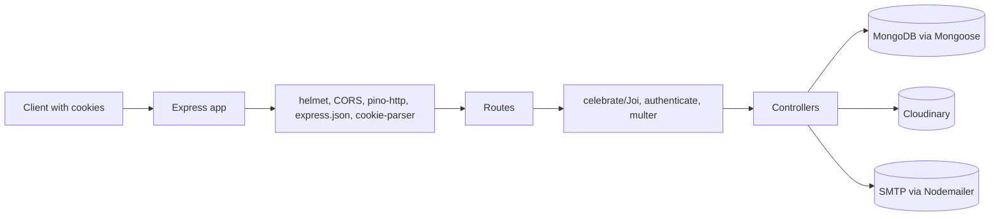
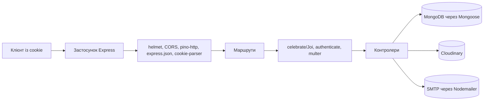

# Green Tourism Backend

[English](#english) | [Українська](#українська)

REST API for an eco-tourism content platform. The service stores travel stories, categories, users and bookmarks in MongoDB, authenticates users with server-side sessions delivered as HttpOnly cookies, uploads images to Cloudinary, sends email-change confirmations through SMTP, and exposes an OpenAPI 3.0 document through Swagger UI at `/api-docs`.

---

## English

### Table of Contents

- [Overview](#overview)
- [Purpose](#purpose)
- [Key Features](#key-features)
- [Technology Stack](#technology-stack)
- [Architecture](#architecture)
- [Project Structure](#project-structure)
- [Prerequisites](#prerequisites)
- [Installation](#installation)
- [Environment Variables](#environment-variables)
- [Database Setup](#database-setup)
- [Running the Application](#running-the-application)
- [API Reference](#api-reference)
  - [Conventions](#conventions)
  - [Endpoint Summary](#endpoint-summary)
  - [Auth Endpoints](#auth-endpoints)
  - [User Endpoints](#user-endpoints)
  - [Story Endpoints](#story-endpoints)
  - [Category Endpoints](#category-endpoints)
- [Authentication and Authorization](#authentication-and-authorization)
- [Validation, Pagination and File Uploads](#validation-pagination-and-file-uploads)
- [Data Models](#data-models)
- [Error Handling](#error-handling)
- [Testing and Linting](#testing-and-linting)
- [npm Scripts](#npm-scripts)
- [Docker and Deployment](#docker-and-deployment)
- [Security Considerations](#security-considerations)
- [Troubleshooting](#troubleshooting)
- [Contributing](#contributing)
- [License](#license)
- [Repository and Contact](#repository-and-contact)

### Overview

**Green Tourism Backend** is a Node.js REST API built with Express 5 and MongoDB (Mongoose). It is the server-side part of a green tourism application: clients can browse stories and categories, register and log in, publish illustrated travel stories, edit their profile, upload an avatar, and save stories to a personal collection.

The API uses database-backed sessions rather than bearer tokens in headers. Registering, logging in, or refreshing a session sets three cookies (`sessionId`, `accessToken`, `refreshToken`), which the client must send with every protected request. Interactive documentation is served at `/api-docs` from the checked-in `swagger.json` file.

### Purpose

The project solves the backend needs of an eco-tourism content platform:

- Publish and discover travel stories with a cover image and a category.
- Rank stories by a `rate` counter that increases when users save a story.
- Support a personal profile, avatar management, and a saved-stories collection.
- Provide a confirmation flow for changing an account email address.
- Offer a documented HTTP API that a separate frontend can consume.

### Key Features

- Session-based authentication with `sessionId`, `accessToken`, and `refreshToken` cookies.
- Access-token lifetime of 15 minutes; refresh-token and session lifetimes of 24 hours.
- User registration, login, logout, and session refresh.
- Story listing with pagination, category filtering, and a `popular` sort mode.
- Recommended stories ordered by `rate`.
- Story details with populated category and owner data.
- Authenticated story creation with a cover image uploaded to Cloudinary.
- User listing and public user profiles with their stories.
- Profile updates, avatar uploads, and an email-change confirmation flow using JWT and SMTP.
- Add/remove saved stories; saving increments the story rate, removing decrements it.
- Request validation with Celebrate/Joi.
- Centralized 404 and error handling.
- OpenAPI 3.0 specification and Swagger UI.

### Technology Stack

Runtime dependencies are taken from `package.json`.

| Technology         | Declared version                                                   | Role                                                                    |
| ------------------ | ------------------------------------------------------------------ | ----------------------------------------------------------------------- |
| Node.js            | No `engines` field; `mongoose@9.11.2` requires Node.js `>=20.19.0` | JavaScript runtime; the project uses ES modules (`"type": "module"`)    |
| Express            | `^5.3.0`                                                           | HTTP framework and routing                                              |
| MongoDB            | Not pinned                                                         | Database                                                                |
| Mongoose           | `^9.11.2`                                                          | ODM, schemas, indexes                                                   |
| bcrypt             | `^6.0.0`                                                           | Password hashing (cost factor 10)                                       |
| jsonwebtoken       | `^9.0.3`                                                           | Email-change JWT signing and verification                               |
| celebrate          | `^16.0.0`                                                          | Joi-based request validation                                            |
| cookie-parser      | `^1.4.7`                                                           | Cookie parsing                                                          |
| cors               | `^2.8.6`                                                           | CORS with a single configured origin                                    |
| helmet             | `^8.3.0`                                                           | Security-related HTTP headers                                           |
| multer             | `^2.4.0`                                                           | In-memory multipart file uploads                                        |
| cloudinary         | `^2.11.0`                                                          | Image storage and transformations                                       |
| nodemailer         | `^10.1.2`                                                          | SMTP email delivery                                                     |
| handlebars         | `^4.7.10`                                                          | Email HTML template rendering                                           |
| pino-http          | `^11.0.0`                                                          | HTTP request logging                                                    |
| pino-pretty        | `^13.2.0`                                                          | Pretty log output                                                       |
| http-errors        | `^2.0.1`                                                           | HTTP error creation                                                     |
| swagger-ui-express | `^5.0.1`                                                           | Swagger UI hosting                                                      |
| dotenv             | `^18.0.8`                                                          | Environment variable loading                                            |
| crypto             | `^1.0.1`                                                           | Declared dependency; the code uses Node's built-in `node:crypto` module |

Development tooling:

| Tool                   | Declared version | Role                              |
| ---------------------- | ---------------- | --------------------------------- |
| nodemon                | `^3.1.14`        | Development auto-restart          |
| eslint                 | `^10.13.0`       | Linting                           |
| @eslint/js             | `^10.0.1`        | ESLint recommended rules          |
| eslint-config-prettier | `^10.1.8`        | Disables conflicting ESLint rules |
| globals                | `^17.13.0`       | Node.js globals for ESLint        |
| prettier               | `^3.9.10`        | Code formatting                   |

### Architecture

The application follows a layered Express structure:

1. `src/server.js` creates the app, registers global middleware, mounts routers, registers 404/error middleware, connects to MongoDB, and starts the HTTP server.
2. Routes apply Celebrate validation, the `authenticate` middleware, and Multer where needed.
3. Controllers contain the request logic and call Mongoose models, Cloudinary utilities, email utilities, or session services.
4. Mongoose models define the data shape, defaults, validation, and indexes.
5. `errorHandler` converts `http-errors` instances into JSON responses and falls back to HTTP 500 for unexpected errors.



### Project Structure

```text
final_project_BackEnd/
├── src/
│   ├── constants/
│   │   └── time.js
│   ├── controllers/
│   │   ├── auth/
│   │   │   └── authController.js
│   │   ├── categories/
│   │   │   └── categoriesController.js
│   │   ├── stories/
│   │   │   └── storyController.js
│   │   └── users/
│   │       ├── profileController.js
│   │       ├── savedArticlesController.js
│   │       └── userController.js
│   ├── db/
│   │   └── connectToMongoDB.js
│   ├── middleware/
│   │   ├── authenticate.js
│   │   ├── errorHandler.js
│   │   ├── logger.js
│   │   ├── multer.js
│   │   └── notFoundHandler.js
│   ├── models/
│   │   ├── category.js
│   │   ├── session.js
│   │   ├── story.js
│   │   └── user.js
│   ├── routes/
│   │   ├── authRoutes.js
│   │   ├── categoriesRoutes.js
│   │   ├── storyRoutes.js
│   │   └── usersRoutes.js
│   ├── services/
│   │   └── auth.js
│   ├── templates/
│   │   └── confirm-email-change.html
│   ├── utils/
│   │   ├── saveFileToCloudinary.js
│   │   └── sendEmail.js
│   ├── validations/
│   │   ├── authValidation.js
│   │   ├── storyValidation.js
│   │   └── userValidation.js
│   └── server.js
├── .env.example
├── .gitignore
├── .prettierignore
├── .prettierrc
├── eslint.config.js
├── package-lock.json
├── package.json
├── readme.md
└── swagger.json
```

### Prerequisites

- **Node.js 20.19 or newer** (required by the installed Mongoose 9 engine; the repository does not declare an `engines` field).
- **npm** (a `package-lock.json` is present).
- A **MongoDB** deployment: a local server or a MongoDB Atlas cluster.
- A **Cloudinary** account for cover and avatar uploads.
- An **SMTP** account for email-change confirmations. `.env.example` labels these settings as Brevo credentials, but any SMTP provider works.
- A modern browser for Swagger UI and for testing cookie behavior.
- HTTPS in frontend deployments because session cookies are created with `Secure` and `SameSite=None`.

### Installation

```bash
git clone https://github.com/zeman-dev/Green_tourism_BackEnd.git
cd Green_tourism_BackEnd
npm install
```

Create the local environment file:

```bash
cp .env.example .env
```

Windows PowerShell:

```powershell
Copy-Item .env.example .env
```

Then fill in the values described below. The `.env` file is ignored by Git; `.env.example` contains names only.

There is no build step. The server runs directly from source with `node src/server.js`.

### Environment Variables

All variables are read from `.env` through `dotenv/config`.

| Variable                | Required              | Description                                                | Default / notes                                                                                                  |
| ----------------------- | --------------------- | ---------------------------------------------------------- | ---------------------------------------------------------------------------------------------------------------- |
| `MONGO_URL`             | Yes                   | MongoDB connection string used by `mongoose.connect()`     | No default. The process exits with code 1 if the connection fails.                                               |
| `PORT`                  | No                    | HTTP port                                                  | Falls back to `3000` in `src/server.js`.                                                                         |
| `NODE_ENV`              | No                    | Environment name                                           | Only affects the error handler: `production` returns `err.message`; otherwise the response contains `err.stack`. |
| `SMTP_HOST`             | Yes for email changes | SMTP server hostname                                       | Passed to `nodemailer.createTransport`.                                                                          |
| `SMTP_PORT`             | Yes for email changes | SMTP port as a number                                      | Port `465` enables `secure: true`; other ports use non-secure mode.                                              |
| `SMTP_USER`             | Yes for email changes | SMTP username                                              | —                                                                                                                |
| `SMTP_PASSWORD`         | Yes for email changes | SMTP password                                              | —                                                                                                                |
| `SMTP_FROM`             | Yes for email changes | Sender address                                             | Used as the `from` field of outgoing email.                                                                      |
| `JWT_SECRET`            | Yes for email changes | Secret used to sign and verify email-change JWTs           | Tokens expire after 1 hour.                                                                                      |
| `FRONTEND_DOMAIN`       | Yes                   | Allowed CORS origin and base URL for the confirmation link | Must include the scheme. A trailing slash would produce a double slash before `/confirm-email`.                  |
| `CLOUDINARY_CLOUD_NAME` | Yes for uploads       | Cloudinary cloud name                                      | —                                                                                                                |
| `CLOUDINARY_API_KEY`    | Yes for uploads       | Cloudinary API key                                         | —                                                                                                                |
| `CLOUDINARY_API_SECRET` | Yes for uploads       | Cloudinary API secret                                      | —                                                                                                                |

Example `.env` with placeholders:

```dotenv
MONGO_URL=mongodb+srv://<user>:<password>@<cluster>/<database>
PORT=3005
SMTP_HOST=smtp.example.com
SMTP_PORT=587
SMTP_USER=<smtp-user>
SMTP_PASSWORD=<smtp-password>
SMTP_FROM="Green Tourism <no-reply@example.com>"
JWT_SECRET=<long-random-secret>
FRONTEND_DOMAIN=https://example-frontend.com
CLOUDINARY_CLOUD_NAME=<cloud-name>
CLOUDINARY_API_KEY=<api-key>
CLOUDINARY_API_SECRET=<api-secret>
NODE_ENV=development
```

Do not commit real credentials. The repository's `.gitignore` excludes `.env` and `.env.*` while keeping `.env.example`.

### Database Setup

- The connection is established in `src/db/connectToMongoDB.js` before the HTTP server starts.
- The module sets `dns.setServers(['8.8.8.8'])` before connecting.
- If `mongoose.connect()` fails, the error is logged and the process exits with code 1.
- There are **no migration scripts, seed scripts, or database CLI commands** in the repository.
- Collections are created by Mongoose when documents are written. The models also declare indexes (see [Data Models](#data-models)).
- Categories are read-only through the API (`GET /api/categories`). To create stories, category documents must already exist.

For local development, categories can be inserted manually, for example with `mongosh`:

```javascript
use green_tourism
db.categories.insertMany([
  { category: 'Hiking' },
  { category: 'Eco-lodging' }
])
```

Category names are unique and are matched exactly when filtering stories by the `category` query parameter.

### Running the Application

Development mode with auto-restart:

```bash
npm run dev
```

Production-style start:

```bash
npm start
```

The server listens on `PORT`, or `3000` when `PORT` is empty or absent. Run the commands from the repository root because the email template path is resolved relative to the working directory with `path.resolve('src', 'templates', 'confirm-email-change.html')`.

Swagger UI is available at:

```text
http://localhost:3000/api-docs
```

Replace `3000` with the configured `PORT`. The `servers` entries in `swagger.json` currently list `http://localhost:3005` and `http://localhost:3000`; if you use a different port, the Swagger "Try it out" requests will target the listed URLs until `swagger.json` is updated or the server is started on one of those ports. The Swagger route removes the `Content-Security-Policy` header so the UI can load.

### API Reference

#### Conventions

- **Base URL:** `http://localhost:<PORT>`, where `<PORT>` is `PORT` or `3000`.
- **Content types:** `application/json` for normal requests; `multipart/form-data` for avatar and story-image uploads.
- **Authentication:** protected endpoints require the three cookies set by register/login/refresh. Browsers send them automatically when `credentials: 'include'` is used; CLI clients must use a cookie jar.
- **Object IDs:** path parameters documented as ObjectIds must be 24 hexadecimal characters. Celebrate rejects other values with HTTP 400.
- **Dates:** MongoDB dates are serialized as ISO 8601 strings.
- **Pagination:** list responses use `page`, `perPage`, `totalStories` or `totalUsers`, `totalPages`, and the array field.
- **Errors:** `http-errors` errors produce `{ "message": "..." }`. Celebrate validation errors produce a richer structure documented in [Error Handling](#error-handling).
- **Public endpoints:** no authentication middleware is applied.
- **Route order:** `/api/stories/recommended` is declared before `/api/stories/:storyId`, so `recommended` is not interpreted as a story ID.

#### Endpoint Summary

| Method   | Path                                  | Authentication               | Description                                |
| -------- | ------------------------------------- | ---------------------------- | ------------------------------------------ |
| `POST`   | `/api/auth/register`                  | Public                       | Create a user and start a session          |
| `POST`   | `/api/auth/login`                     | Public                       | Verify credentials and start a session     |
| `POST`   | `/api/auth/logout`                    | `sessionId` + `accessToken`  | Delete the current session                 |
| `POST`   | `/api/auth/refresh`                   | `sessionId` + `refreshToken` | Rotate the session                         |
| `GET`    | `/api/users`                          | Public                       | Paginated user list without email/password |
| `GET`    | `/api/users/me`                       | `sessionId` + `accessToken`  | Current user profile                       |
| `PATCH`  | `/api/users/me`                       | `sessionId` + `accessToken`  | Update name and/or request an email change |
| `PATCH`  | `/api/users/me/avatar`                | `sessionId` + `accessToken`  | Upload a new avatar                        |
| `GET`    | `/api/users/me/stories`               | `sessionId` + `accessToken`  | Stories owned by the current user          |
| `GET`    | `/api/users/me/saved-stories`         | `sessionId` + `accessToken`  | Stories saved by the current user          |
| `GET`    | `/api/users/{userId}`                 | Public                       | Public user summary and the user's stories |
| `POST`   | `/api/users/confirm-email`            | Public                       | Apply an email change using a JWT          |
| `POST`   | `/api/users/saved-articles/{storyId}` | `sessionId` + `accessToken`  | Save a story                               |
| `DELETE` | `/api/users/saved-articles/{storyId}` | `sessionId` + `accessToken`  | Remove a saved story                       |
| `GET`    | `/api/stories`                        | Public                       | Paginated story list with filters          |
| `GET`    | `/api/stories/recommended`            | Public                       | Stories ordered by rate                    |
| `GET`    | `/api/stories/{storyId}`              | Public                       | Story details                              |
| `POST`   | `/api/stories`                        | `sessionId` + `accessToken`  | Create a story with a cover image          |
| `GET`    | `/api/categories`                     | Public                       | List categories                            |

#### Auth Endpoints

##### POST /api/auth/register

Creates a user, hashes the password with bcrypt (10 rounds), creates a session, sets the three session cookies, and returns the created user. The password is removed from JSON by the model's `toJSON` method.

| Body field  | Type   | Required | Rules                                                                                           |
| ----------- | ------ | -------- | ----------------------------------------------------------------------------------------------- |
| `name`      | string | Yes      | 2–32 characters, trimmed                                                                        |
| `email`     | string | Yes      | Valid email, maximum 64 characters, trimmed and lowercased                                      |
| `password`  | string | Yes      | 8–72 characters                                                                                 |
| `avatarUrl` | string | No       | Absolute `http` or `https` URI, or an empty string; empty/missing values use the default avatar |

| Status | Meaning                               |
| ------ | ------------------------------------- |
| `201`  | User created; session cookies are set |
| `400`  | Validation failed                     |
| `409`  | `Email in use`                        |
| `500`  | Unexpected error                      |

Example request:

```json
{
  "name": "Olena",
  "email": "olena@example.com",
  "password": "StrongPass123",
  "avatarUrl": "https://example.com/avatar.jpg"
}
```

Example response (`201`):

```json
{
  "_id": "6710f0c2a1b2c3d4e5f60718",
  "name": "Olena",
  "email": "olena@example.com",
  "avatarUrl": "https://example.com/avatar.jpg",
  "articlesAmount": 0,
  "savedArticles": [],
  "createdAt": "2026-01-01T10:00:00.000Z",
  "updatedAt": "2026-01-01T10:00:00.000Z",
  "__v": 0
}
```

The response also contains `Set-Cookie` headers for `sessionId`, `accessToken`, and `refreshToken`.

##### POST /api/auth/login

Validates the credentials, deletes all existing sessions for the user, creates a new session, and sets new cookies.

| Body field | Type   | Required | Rules                                                      |
| ---------- | ------ | -------- | ---------------------------------------------------------- |
| `email`    | string | Yes      | Valid email, maximum 64 characters, trimmed and lowercased |
| `password` | string | Yes      | Maximum 72 characters                                      |

| Status | Meaning                                              |
| ------ | ---------------------------------------------------- |
| `200`  | Logged in; session cookies are set; returns the user |
| `400`  | Validation failed                                    |
| `401`  | `Invalid credentials`                                |
| `500`  | Unexpected error                                     |

Example request:

```json
{
  "email": "olena@example.com",
  "password": "StrongPass123"
}
```

Example response (`200`): the same user object shape as the register response, including `savedArticles`.

##### POST /api/auth/logout

Requires a valid access session. Deletes the session identified by the `sessionId` cookie and clears all three session cookies.

| Status | Meaning                              |
| ------ | ------------------------------------ |
| `204`  | Session deleted; no response body    |
| `401`  | Missing, invalid, or expired session |

Example:

```bash
curl -X POST http://localhost:3000/api/auth/logout -b cookies.txt
```

##### POST /api/auth/refresh

Requires `sessionId` and `refreshToken` cookies. The server finds the matching session, rejects it if the refresh token has expired, deletes the old session, creates a new one, and sets new cookies.

| Status | Meaning                                                                        |
| ------ | ------------------------------------------------------------------------------ |
| `200`  | `{ "message": "Session refreshed" }`; new cookies are set                      |
| `401`  | `Missing session credentials`, `Session not found`, or `Session token expired` |

If the refresh token is expired, the server deletes the session and clears the cookies before returning `401`.

#### User Endpoints

##### GET /api/users

Returns a paginated list of users sorted by `createdAt` descending and `_id` descending. The query selects `-password -email`.

| Query     | Type    | Required | Rules / default      |
| --------- | ------- | -------- | -------------------- |
| `page`    | integer | No       | Minimum 1; default 1 |
| `perPage` | integer | No       | 1–100; default 10    |

Response (`200`):

```json
{
  "page": 1,
  "perPage": 10,
  "totalUsers": 1,
  "totalPages": 1,
  "users": [
    {
      "_id": "6710f0c2a1b2c3d4e5f60718",
      "name": "Olena",
      "avatarUrl": "https://example.com/avatar.jpg",
      "articlesAmount": 0,
      "savedArticles": [],
      "createdAt": "2026-01-01T10:00:00.000Z",
      "updatedAt": "2026-01-01T10:00:00.000Z",
      "__v": 0
    }
  ]
}
```

Possible errors: `400` validation, `500` unexpected error.

##### GET /api/users/me

Returns the authenticated user's subset profile.

Response (`200`):

```json
{
  "user": {
    "_id": "6710f0c2a1b2c3d4e5f60718",
    "name": "Olena",
    "avatarUrl": "https://example.com/avatar.jpg",
    "articlesAmount": 2
  }
}
```

Possible errors: `401` missing/invalid/expired session.

##### PATCH /api/users/me

Updates the name and/or requests an email change. At least one body field must be present.

| Body field | Type   | Required | Rules                                                      |
| ---------- | ------ | -------- | ---------------------------------------------------------- |
| `name`     | string | No       | 2–32 characters, trimmed                                   |
| `email`    | string | No       | Valid email, maximum 64 characters, trimmed and lowercased |

Behavior:

- If `email` differs from the current email, the server checks for an existing account with that email and returns `409` if found.
- The server signs a JWT with `{ sub: userId, email, purpose: 'email-change' }`, valid for 1 hour.
- A confirmation link `${FRONTEND_DOMAIN}/confirm-email?token=...` is rendered into `src/templates/confirm-email-change.html` and sent **to the current email address**, not the new one.
- The response contains the user object and `emailVerificationSent: true` when an email change was requested; otherwise `false`.

Example request:

```json
{
  "name": "Olena K.",
  "email": "olena.new@example.com"
}
```

Example response (`200`):

```json
{
  "user": {
    "_id": "6710f0c2a1b2c3d4e5f60718",
    "name": "Olena K.",
    "email": "olena@example.com",
    "avatarUrl": "https://example.com/avatar.jpg",
    "articlesAmount": 2,
    "savedArticles": []
  },
  "emailVerificationSent": true
}
```

The returned `user` still has the old email until the confirmation endpoint is called. Possible errors: `400` validation, `401` unauthenticated, `409` email already in use, `500` email delivery failure (`Failed to send the email, please try again later.`).

##### PATCH /api/users/me/avatar

Uploads an avatar and updates `avatarUrl`.

| Form field | Type | Required | Rules                             |
| ---------- | ---- | -------- | --------------------------------- |
| `avatar`   | file | Yes      | `image/*` MIME type, maximum 2 MB |

Cloudinary stores avatars in `Green_tourism_BackEnd/avatars` with public ID `avatar_<userId>`, overwriting the previous file. The image is transformed to 500×500 with `crop: fill`, `gravity: auto`, automatic format, and automatic quality.

Response (`200`):

```json
{
  "url": "https://res.cloudinary.com/<cloud>/image/upload/v1234567890/Green_tourism_BackEnd/avatars/avatar_6710f0c2a1b2c3d4e5f60718.jpg"
}
```

Possible errors: `400` `No file`, `401` unauthenticated, `500` for Multer rejection (non-image or file over 2 MB) or Cloudinary failure.

##### GET /api/users/me/stories

Returns stories owned by the authenticated user, sorted by `date` descending and `_id` descending, with `ownerId` populated with `name` and `avatarUrl`.

| Query     | Type    | Required | Rules / default      |
| --------- | ------- | -------- | -------------------- |
| `page`    | integer | No       | Minimum 1; default 1 |
| `perPage` | integer | No       | 5–30; default 10     |

Response (`200`): the standard stories page shape shown under `GET /api/stories`.

Possible errors: `400` validation, `401` unauthenticated.

##### GET /api/users/me/saved-stories

Returns stories whose IDs are in the current user's `savedArticles` array, sorted by `date` descending and `_id` descending, with `ownerId` populated with `name` and `avatarUrl`.

| Query     | Type    | Required | Rules / default                                                                   |
| --------- | ------- | -------- | --------------------------------------------------------------------------------- |
| `page`    | integer | No       | Minimum 1; default 1                                                              |
| `perPage` | integer | No       | 5–30; default 10 (the Joi schema applies this default before the controller runs) |

Response (`200`): the standard stories page shape.

Possible errors: `400` validation, `401` unauthenticated.

##### GET /api/users/{userId}

Returns a public summary and the user's stories.

| Parameter | In    | Type    | Required | Rules                     |
| --------- | ----- | ------- | -------- | ------------------------- |
| `userId`  | path  | string  | Yes      | 24 hexadecimal characters |
| `page`    | query | integer | No       | Minimum 1; default 1      |
| `perPage` | query | integer | No       | 1–100; default 10         |

Response (`200`):

```json
{
  "user": {
    "_id": "6710f0c2a1b2c3d4e5f60718",
    "username": "Olena",
    "articlesAmount": 2
  },
  "page": 1,
  "perPage": 10,
  "totalStories": 2,
  "totalPages": 1,
  "stories": []
}
```

The controller reads `user.avatar`, but the User model defines `avatarUrl`. As a result, the legacy `avatar` field is normally omitted from the JSON response. Use `avatarUrl` from `GET /api/users/me`.

Possible errors: `400` validation, `404` `User not found`, `500` unexpected error.

##### POST /api/users/confirm-email

Consumes the token from the email-change link and applies the new email address.

| Body field | Type   | Required | Rules                               |
| ---------- | ------ | -------- | ----------------------------------- |
| `token`    | string | Yes      | JWT issued by `PATCH /api/users/me` |

| Status | Meaning                                       |
| ------ | --------------------------------------------- |
| `200`  | `{ "message": "Email changed successfully" }` |
| `400`  | Validation failed                             |
| `401`  | `Token is expired or invalid`                 |
| `404`  | `User not found`                              |
| `409`  | `Email in use`                                |

Example request:

```json
{
  "token": "eyJhbGciOiJIUzI1NiIsInR5cCI6IkpXVCJ9..."
}
```

##### POST /api/users/saved-articles/{storyId}

Adds a story to the authenticated user's `savedArticles` using `$addToSet`. The first successful save increments the story's `rate` by 1. Saving the same story again does not increment the rate again.

| Parameter | In   | Type   | Required | Rules                     |
| --------- | ---- | ------ | -------- | ------------------------- |
| `storyId` | path | string | Yes      | 24 hexadecimal characters |

Response (`200`):

```json
{
  "savedArticles": ["6710f0c2a1b2c3d4e5f60718"]
}
```

Possible errors: `400` validation, `401` unauthenticated or user missing, `404` `Story not found`.

##### DELETE /api/users/saved-articles/{storyId}

Removes the story from the user's `savedArticles` using `$pull`. If the story was present, the story's `rate` is decremented by 1 only when the current rate is greater than zero. The endpoint does not check whether the story document exists.

| Parameter | In   | Type   | Required | Rules                     |
| --------- | ---- | ------ | -------- | ------------------------- |
| `storyId` | path | string | Yes      | 24 hexadecimal characters |

Response (`200`): the updated `savedArticles` array, even if the story was not previously saved.

Possible errors: `400` validation, `401` unauthenticated or user missing.

#### Story Endpoints

##### GET /api/stories

Returns a paginated story list. By default the sort is `{ createdAt: -1, _id: -1 }`; with `type=popular` it is `{ rate: -1, _id: 1 }`. The owner is populated with `name`.

| Query      | Type    | Required | Rules / default                                         |
| ---------- | ------- | -------- | ------------------------------------------------------- |
| `page`     | integer | No       | Minimum 1; default 1                                    |
| `perPage`  | integer | No       | 5–30; default 10                                        |
| `category` | string  | No       | Category name; exact match against the `category` field |
| `type`     | string  | No       | Only `popular` is accepted                              |

Response (`200`):

```json
{
  "page": 1,
  "perPage": 10,
  "totalStories": 1,
  "totalPages": 1,
  "stories": [
    {
      "_id": "6710f0c2a1b2c3d4e5f60719",
      "img": "https://res.cloudinary.com/<cloud>/image/upload/Green_tourism_BackEnd/stories/cover.jpg",
      "title": "Weekend in the Carpathians",
      "article": "A short account of a weekend hike in the Carpathian Mountains.",
      "category": "6710f0c2a1b2c3d4e5f60720",
      "rate": 3,
      "ownerId": {
        "_id": "6710f0c2a1b2c3d4e5f60718",
        "name": "Olena"
      },
      "date": "2026-01-01T10:00:00.000Z",
      "createdAt": "2026-01-01T10:00:00.000Z",
      "updatedAt": "2026-01-01T10:00:00.000Z",
      "__v": 0
    }
  ]
}
```

Possible errors: `400` validation, `404` `Category not found` when the filter does not match a category, `500` unexpected error.

##### GET /api/stories/recommended

Returns stories ordered by `{ rate: -1, _id: 1 }`. The optional `category` filter is matched by name. Unlike `GET /api/stories`, this handler does not populate `ownerId`, so it is returned as a raw ObjectId.

| Query      | Type    | Required | Rules / default            |
| ---------- | ------- | -------- | -------------------------- |
| `page`     | integer | No       | Minimum 1; default 1       |
| `perPage`  | integer | No       | 5–30; default 5            |
| `category` | string  | No       | Category name; exact match |

Response (`200`): the standard stories page shape.

Possible errors: `400` validation, `404` `Category not found`, `500` unexpected error.

##### GET /api/stories/{storyId}

Returns one story with `category` populated with `category` and `ownerId` populated with `name`.

| Parameter | In   | Type   | Required | Rules                     |
| --------- | ---- | ------ | -------- | ------------------------- |
| `storyId` | path | string | Yes      | 24 hexadecimal characters |

Response (`200`):

```json
{
  "_id": "6710f0c2a1b2c3d4e5f60719",
  "img": "https://res.cloudinary.com/<cloud>/image/upload/Green_tourism_BackEnd/stories/cover.jpg",
  "title": "Weekend in the Carpathians",
  "article": "A short account of a weekend hike in the Carpathian Mountains.",
  "category": {
    "_id": "6710f0c2a1b2c3d4e5f60720",
    "category": "Hiking"
  },
  "rate": 3,
  "ownerId": {
    "_id": "6710f0c2a1b2c3d4e5f60718",
    "name": "Olena"
  },
  "date": "2026-01-01T10:00:00.000Z",
  "createdAt": "2026-01-01T10:00:00.000Z",
  "updatedAt": "2026-01-01T10:00:00.000Z",
  "__v": 0
}
```

Possible errors: `400` validation, `404` `Story not found`, `500` unexpected error.

##### POST /api/stories

Creates a story for the authenticated user. The cover image is uploaded to Cloudinary, then the story is created and the owner's `articlesAmount` is incremented by 1.

| Form field | Type   | Required | Rules                                              |
| ---------- | ------ | -------- | -------------------------------------------------- |
| `img`      | file   | Yes      | `image/*` MIME type, maximum 2 MB                  |
| `title`    | string | Yes      | 2–40 characters, trimmed                           |
| `article`  | string | Yes      | 12–3000 characters, trimmed                        |
| `category` | string | Yes      | 24 hexadecimal characters; the category must exist |

Cloudinary stores story images in `Green_tourism_BackEnd/stories`, limits width to 1200 pixels without enlargement, and applies automatic format and quality.

| Status | Meaning                                                              |
| ------ | -------------------------------------------------------------------- |
| `201`  | Story created; returns the story document                            |
| `400`  | Validation failed, or `Cover image is required`                      |
| `401`  | Unauthenticated                                                      |
| `404`  | `Category not found`                                                 |
| `500`  | Cloudinary failure or Multer rejection (non-image or file over 2 MB) |

Example with `curl`:

```bash
curl -X POST http://localhost:3000/api/stories \
  -b cookies.txt \
  -F "img=@cover.jpg" \
  -F "title=Weekend in the Carpathians" \
  -F "article=A short account of a weekend hike in the Carpathian Mountains." \
  -F "category=6710f0c2a1b2c3d4e5f60720"
```

#### Category Endpoints

##### GET /api/categories

Returns all categories sorted alphabetically by `category` ascending.

Response (`200`):

```json
[
  {
    "_id": "6710f0c2a1b2c3d4e5f60720",
    "category": "Hiking"
  },
  {
    "_id": "6710f0c2a1b2c3d4e5f60721",
    "category": "Eco-lodging"
  }
]
```

Possible errors: `500` unexpected error.

### Authentication and Authorization

Authentication is **session-based** and stored in MongoDB:

1. `POST /api/auth/register` or `POST /api/auth/login` calls `createSession(userId)`, which creates a `Session` document with random UUID access and refresh tokens and their expiry dates.
2. `setSessionCookies()` writes `sessionId`, `accessToken`, and `refreshToken` as `HttpOnly`, `Secure`, `SameSite=None` cookies. Access token lifetime is 15 minutes; refresh token and session cookie lifetime is 24 hours.
3. Protected routes use `authenticate`, which requires both `sessionId` and `accessToken`, finds the exact session, checks `accessTokenValidUntil`, loads the user, and assigns it to `req.user`.
4. `POST /api/auth/refresh` requires `sessionId` and `refreshToken`, checks the refresh expiry, deletes the old session, creates a new session, and sets new cookies.
5. `POST /api/auth/logout` requires a valid access session, deletes the session by `sessionId`, and clears all three cookies.

There are **no roles or permission levels**. Any authenticated user can create stories and manage their own saved-stories list; the API does not implement role-based access control. Email-change tokens are separate JWTs with `purpose: 'email-change'`, signed with `JWT_SECRET`, and valid for 1 hour.

Because cookies use `Secure` and `SameSite=None`, production clients must use HTTPS and the frontend origin must exactly match `FRONTEND_DOMAIN`. CORS is configured with `credentials: true`, so the frontend must also send credentials.

### Validation, Pagination and File Uploads

Validation is implemented with Celebrate and Joi schemas in `src/validations/`.

| Schema                        | Applied to                                                           | Rules                                                                                                                         |
| ----------------------------- | -------------------------------------------------------------------- | ----------------------------------------------------------------------------------------------------------------------------- |
| `registerUserSchema`          | `POST /api/auth/register` body                                       | `name` 2–32 trimmed; `email` valid, max 64, trimmed, lowercased; `password` 8–72; `avatarUrl` optional http/https URI or `''` |
| `loginUserSchema`             | `POST /api/auth/login` body                                          | `email` valid, max 64, trimmed, lowercased; `password` max 72                                                                 |
| `getAllStoriesSchema`         | `GET /api/stories` query                                             | `page` ≥ 1, default 1; `perPage` 5–30, default 10; optional `category`; optional `type` equal to `popular`                    |
| `getRecommendedStoriesSchema` | `GET /api/stories/recommended` query                                 | `page` ≥ 1, default 1; `perPage` 5–30, default 5; optional `category`                                                         |
| `getStoryByIdSchema`          | `GET /api/stories/:storyId` params                                   | `storyId` 24 hex characters                                                                                                   |
| `createStorySchema`           | `POST /api/stories` body                                             | `title` 2–40 trimmed; `article` 12–3000 trimmed; `category` 24 hex characters                                                 |
| `paginationSchema`            | `GET /api/users/me/stories`, `GET /api/users/me/saved-stories` query | `page` ≥ 1, default 1; `perPage` 5–30, default 10                                                                             |
| `getUsersSchema`              | `GET /api/users` query                                               | `page` ≥ 1, default 1; `perPage` 1–100, default 10                                                                            |
| `getUserWithStoriesSchema`    | `GET /api/users/:userId`                                             | `userId` 24 hex characters; `page` ≥ 1, default 1; `perPage` 1–100, default 10                                                |
| `savedArticleParamsSchema`    | Saved-article routes params                                          | `storyId` 24 hex characters                                                                                                   |
| `updateUserSchema`            | `PATCH /api/users/me` body                                           | At least one field; `name` 2–32 trimmed; `email` valid, max 64, trimmed, lowercased                                           |
| `confirmEmailSchema`          | `POST /api/users/confirm-email` body                                 | `token` required string                                                                                                       |

Pagination responses have the following shape:

```json
{
  "page": 1,
  "perPage": 10,
  "totalStories": 42,
  "totalPages": 5,
  "stories": []
}
```

User lists use `totalUsers` instead of `totalStories`.

File uploads use Multer with memory storage:

- Maximum file size: **2 MB**.
- Accepted MIME types: any type starting with `image/`.
- Story cover field: `img`.
- Avatar field: `avatar`.

Multer errors (wrong MIME type or oversized file) are plain `Error` objects, not `http-errors`, so they reach the generic 500 branch of `errorHandler`. A missing file is handled explicitly by the controllers: `No file` for avatars and `Cover image is required` for stories (HTTP 400).

### Data Models

#### User

| Field                    | Type       | Rules / default                                                     |
| ------------------------ | ---------- | ------------------------------------------------------------------- |
| `name`                   | string     | Required, trimmed, max 32                                           |
| `email`                  | string     | Required, unique, trimmed, lowercased                               |
| `password`               | string     | Required, excluded from queries by default (`select: false`)        |
| `avatarUrl`              | string     | Default `https://ac.goit.global/fullstack/react/default-avatar.jpg` |
| `articlesAmount`         | number     | Minimum 0, default 0                                                |
| `savedArticles`          | ObjectId[] | References `Story`, default `[]`                                    |
| `createdAt`, `updatedAt` | Date       | Added by `timestamps: true`                                         |

`toJSON` removes `password`.

#### Story

| Field                    | Type     | Rules / default                   |
| ------------------------ | -------- | --------------------------------- |
| `img`                    | string   | Required; Cloudinary URL          |
| `title`                  | string   | Required, trimmed, 2–40           |
| `article`                | string   | Required, trimmed, 12–3000        |
| `category`               | ObjectId | Required, references `Categories` |
| `rate`                   | number   | Required, minimum 0, default 0    |
| `ownerId`                | ObjectId | Required, references `User`       |
| `date`                   | Date     | Required, default `Date.now`      |
| `createdAt`, `updatedAt` | Date     | Added by `timestamps: true`       |

Indexes: `{ ownerId: 1 }`, `{ rate: -1, _id: 1 }`, `{ category: 1, rate: -1, _id: 1 }`.

#### Categories

| Field      | Type   | Rules                     |
| ---------- | ------ | ------------------------- |
| `category` | string | Required, trimmed, unique |

#### Session

| Field                    | Type     | Rules                       |
| ------------------------ | -------- | --------------------------- |
| `userId`                 | ObjectId | Required                    |
| `accessToken`            | string   | Required                    |
| `refreshToken`           | string   | Required                    |
| `accessTokenValidUntil`  | Date     | Required                    |
| `refreshTokenValidUntil` | Date     | Required                    |
| `createdAt`, `updatedAt` | Date     | Added by `timestamps: true` |

### Error Handling

Middleware order in `src/server.js`: routes → `notFoundHandler` → Celebrate `errors()` → `errorHandler`.

- Unknown routes return `404` with `{ "message": "Route not found" }`.
- Errors created with `http-errors` are returned with their status and `{ "message": "..." }`.
- Celebrate validation errors use its default JSON structure:

```json
{
  "statusCode": 400,
  "error": "Bad Request",
  "message": "\"email\" must be a valid email",
  "validation": {
    "body": {
      "source": "body",
      "keys": ["email"],
      "message": "\"email\" must be a valid email"
    }
  }
}
```

- Other errors return `500`. With `NODE_ENV=production` the response contains `err.message`; otherwise it contains `err.stack`.
- Because Multer errors are not `http-errors`, invalid uploads produce the generic `500` response rather than `400`.

### Testing and Linting

The repository has **no test framework and no test files**. The `test` script is intentionally a placeholder:

```json
"test": "echo \"Error: no test specified\" && exit 1"
```

Linting and formatting commands:

```bash
npm run lint
npm run format
npm run format:check
```

ESLint uses the flat configuration in `eslint.config.js` with `globals.node`, `no-unused-vars` (arguments ignored), and `no-undef`. Prettier is configured in `.prettierrc` and `.prettierignore` excludes `package-lock.json` and `node_modules`.

### npm Scripts

| Script         | Command                                     | Purpose                              |
| -------------- | ------------------------------------------- | ------------------------------------ |
| `start`        | `node src/server.js`                        | Start the server                     |
| `dev`          | `nodemon src/server.js`                     | Start with auto-restart              |
| `test`         | `echo "Error: no test specified" && exit 1` | Placeholder that exits with an error |
| `lint`         | `eslint .`                                  | Run ESLint                           |
| `format`       | `prettier --write .`                        | Format files in place                |
| `format:check` | `prettier --check .`                        | Check formatting without writing     |

Note: `package.json` declares `"main": "index.js"`, but no `index.js` exists; the actual entry point is `src/server.js` via the `start` and `dev` scripts.

### Docker and Deployment

No `Dockerfile`, `docker-compose` file, CI workflow, or deployment manifest is present in the repository. Docker instructions are therefore not provided.

For a production-style deployment using the existing scripts:

```bash
npm ci --omit=dev
NODE_ENV=production npm start
```

The process requires a reachable MongoDB instance, valid Cloudinary credentials, SMTP settings, a strong `JWT_SECRET`, and an HTTPS frontend origin in `FRONTEND_DOMAIN`. A reverse proxy and process manager are not included in the repository and must be supplied by the deployment environment. The server must be started from the repository root so the email template path resolves correctly.

### Security Considerations

Implemented:

- Passwords are hashed with bcrypt using 10 rounds.
- Password hashes are excluded from queries (`select: false`) and removed by `toJSON`.
- Session cookies are `HttpOnly`, `Secure`, and `SameSite=None`.
- Access sessions expire after 15 minutes; refresh sessions after 24 hours.
- Login deletes all previous sessions for the user.
- Email-change JWTs expire after 1 hour and are bound to a `purpose` claim.
- Helmet sets security-related headers.
- CORS accepts only `FRONTEND_DOMAIN` and allows credentials.
- Joi validates request bodies, query strings, and path parameters.
- Uploads are restricted to `image/*` and 2 MB.
- Error stack traces are exposed only when `NODE_ENV` is not `production`.

Not implemented in the repository:

- Rate limiting or brute-force protection.
- CSRF tokens or origin verification beyond CORS.
- Role-based authorization or account lockout.
- A `LICENSE` file (the license is declared only in `package.json`).

### Troubleshooting

| Symptom                                                           | Likely cause and fix                                                                                                                                                          |
| ----------------------------------------------------------------- | ----------------------------------------------------------------------------------------------------------------------------------------------------------------------------- |
| The process exits immediately with `Failed to connect to MongoDB` | `MONGO_URL` is missing, invalid, or unreachable. The code calls `process.exit(1)`. Verify the connection string and network access.                                           |
| Browser requests fail with CORS errors                            | `FRONTEND_DOMAIN` must exactly match the browser origin, including scheme and port. CORS is configured with `credentials: true`, so the frontend must send credentials.       |
| Cookies are not stored or sent                                    | They are `Secure` and `SameSite=None`. Use HTTPS (or a browser context that treats the origin as secure) and make sure the API and frontend origins are configured correctly. |
| Swagger "Try it out" calls the wrong port                         | `swagger.json` lists `http://localhost:3005` and `http://localhost:3000`. Start the server on one of those ports or update the `servers` array.                               |
| `Category not found` when creating a story                        | The `category` ObjectId must reference an existing document in the `categories` collection. There is no seed script; insert categories manually.                              |
| Email-change request returns `500 Failed to send the email`       | Check `SMTP_HOST`, `SMTP_PORT`, `SMTP_USER`, `SMTP_PASSWORD`, and `SMTP_FROM`. Port `465` enables TLS; other ports use non-secure mode.                                       |
| Avatar or story upload returns `500`                              | The file is not an `image/*` type, exceeds 2 MB, or Cloudinary credentials are invalid. Multer errors are not converted to 400.                                               |
| Email template cannot be read                                     | Start the process from the repository root; the template path is resolved relative to the current working directory.                                                          |
| `npm test` fails                                                  | This is expected: the script is a placeholder and no tests exist.                                                                                                             |
| `Path` or `Content-Security-Policy` issues in Swagger UI          | The Swagger route explicitly removes the CSP header; make sure the request reaches `/api-docs`.                                                                               |

### Contributing

There is no `CONTRIBUTING.md` and no CI configuration in the repository. To contribute:

1. Fork the repository and create a feature branch.
2. Install dependencies with `npm install`.
3. Keep changes consistent with the existing ESLint and Prettier configuration.
4. Run `npm run lint` and `npm run format:check` before opening a pull request.
5. Open a pull request against the repository. Describe any API or environment changes explicitly.

### License

The project declares the **ISC** license in `package.json`. No `LICENSE` file is included in the repository.

### Repository and Contact

- Repository: [github.com/zeman-dev/Green_tourism_BackEnd](https://github.com/zeman-dev/Green_tourism_BackEnd)
- Issues: [github.com/zeman-dev/Green_tourism_BackEnd/issues](https://github.com/zeman-dev/Green_tourism_BackEnd/issues)
- Author/maintainer contact: not specified in `package.json` (the `author` field is empty).

---

## Українська

### Зміст

- [Огляд](#огляд)
- [Призначення](#призначення)
- [Ключові можливості](#ключові-можливості)
- [Технологічний стек](#технологічний-стек)
- [Архітектура](#архітектура)
- [Структура проєкту](#структура-проєкту)
- [Попередні вимоги](#попередні-вимоги)
- [Встановлення](#встановлення)
- [Змінні середовища](#змінні-середовища)
- [Налаштування бази даних](#налаштування-бази-даних)
- [Запуск застосунку](#запуск-застосунку)
- [Довідник API](#довідник-api)
  - [Угоди](#угоди)
  - [Зведення ендпоінтів](#зведення-ендпоінтів)
  - [Ендпоінти автентифікації](#ендпоінти-автентифікації)
  - [Ендпоінти користувачів](#ендпоінти-користувачів)
  - [Ендпоінти історій](#ендпоінти-історій)
  - [Ендпоінти категорій](#ендпоінти-категорій)
- [Автентифікація та авторизація](#автентифікація-та-авторизація)
- [Валідація, пагінація та завантаження файлів](#валідація-пагінація-та-завантаження-файлів)
- [Моделі даних](#моделі-даних)
- [Обробка помилок](#обробка-помилок)
- [Тестування та лінтинг](#тестування-та-лінтинг)
- [npm-скрипти](#npm-скрипти)
- [Docker і розгортання](#docker-і-розгортання)
- [Безпека](#безпека)
- [Усунення несправностей](#усунення-несправностей)
- [Участь у розробці](#участь-у-розробці)
- [Ліцензія](#ліцензія)
- [Репозиторій і контакти](#репозиторій-і-контакти)

### Огляд

**Green Tourism Backend** — це REST API на Node.js, побудований на Express 5 і MongoDB (Mongoose). Це серверна частина застосунку для зеленого туризму: клієнти можуть переглядати історії та категорії, реєструватися й входити, публікувати ілюстровані історії подорожей, редагувати профіль, завантажувати аватар і зберігати історії в особисту колекцію.

API використовує сесії, що зберігаються в базі даних, а не bearer-токени в заголовках. Реєстрація, вхід або оновлення сесії встановлюють три cookie (`sessionId`, `accessToken`, `refreshToken`), які клієнт має надсилати з кожним захищеним запитом. Інтерактивна документація доступна за адресою `/api-docs` і генерується з файлу `swagger.json`, що зберігається в репозиторії.

### Призначення

Проєкт забезпечує серверні потреби платформи екотуристичного контенту:

- Публікація та пошук історій подорожей з обкладинкою й категорією.
- Ранжування історій за лічильником `rate`, який збільшується, коли користувачі зберігають історію.
- Особистий профіль, керування аватаром і колекція збережених історій.
- Потік підтвердження зміни email-адреси акаунта.
- Задокументований HTTP API, який може використовувати окремий фронтенд.

### Ключові можливості

- Автентифікація на основі сесій із cookie `sessionId`, `accessToken` і `refreshToken`.
- Час життя access-токена — 15 хвилин; refresh-токена та сесії — 24 години.
- Реєстрація, вхід, вихід і оновлення сесії.
- Список історій з пагінацією, фільтром за категорією та режимом сортування `popular`.
- Рекомендовані історії, впорядковані за `rate`.
- Деталі історії з підвантаженими даними категорії та власника.
- Створення історії для автентифікованого користувача із завантаженням обкладинки в Cloudinary.
- Список користувачів і публічні профілі користувачів з їхніми історіями.
- Оновлення профілю, завантаження аватара й підтвердження зміни email через JWT і SMTP.
- Додавання та видалення збережених історій; збереження збільшує `rate` історії, видалення зменшує його.
- Валідація запитів через Celebrate/Joi.
- Централізована обробка 404 та помилок.
- Специфікація OpenAPI 3.0 і Swagger UI.

### Технологічний стек

Робочі залежності взяті з `package.json`.

| Технологія         | Оголошена версія                                                    | Роль                                                                                |
| ------------------ | ------------------------------------------------------------------- | ----------------------------------------------------------------------------------- |
| Node.js            | Поля `engines` немає; `mongoose@9.11.2` вимагає Node.js `>=20.19.0` | Середовище виконання JavaScript; проєкт використовує ES-модулі (`"type": "module"`) |
| Express            | `^5.3.0`                                                            | HTTP-фреймворк і маршрутизація                                                      |
| MongoDB            | Не зафіксовано                                                      | База даних                                                                          |
| Mongoose           | `^9.11.2`                                                           | ODM, схеми, індекси                                                                 |
| bcrypt             | `^6.0.0`                                                            | Гешування паролів (коефіцієнт 10)                                                   |
| jsonwebtoken       | `^9.0.3`                                                            | Підписування та перевірка JWT для зміни email                                       |
| celebrate          | `^16.0.0`                                                           | Валідація запитів на основі Joi                                                     |
| cookie-parser      | `^1.4.7`                                                            | Розбір cookie                                                                       |
| cors               | `^2.8.6`                                                            | CORS з одним налаштованим origin                                                    |
| helmet             | `^8.3.0`                                                            | Безпекові HTTP-заголовки                                                            |
| multer             | `^2.4.0`                                                            | Завантаження multipart-файлів у пам'ять                                             |
| cloudinary         | `^2.11.0`                                                           | Зберігання зображень і трансформації                                                |
| nodemailer         | `^10.1.2`                                                           | Надсилання пошти через SMTP                                                         |
| handlebars         | `^4.7.10`                                                           | Рендеринг HTML-шаблону листа                                                        |
| pino-http          | `^11.0.0`                                                           | Логування HTTP-запитів                                                              |
| pino-pretty        | `^13.2.0`                                                           | Форматований вивід логів                                                            |
| http-errors        | `^2.0.1`                                                            | Створення HTTP-помилок                                                              |
| swagger-ui-express | `^5.0.1`                                                            | Розміщення Swagger UI                                                               |
| dotenv             | `^18.0.8`                                                           | Завантаження змінних середовища                                                     |
| crypto             | `^1.0.1`                                                            | Оголошена залежність; код використовує вбудований модуль Node.js `node:crypto`      |

Інструменти розробки:

| Інструмент             | Оголошена версія | Роль                                |
| ---------------------- | ---------------- | ----------------------------------- |
| nodemon                | `^3.1.14`        | Автоперезапуск у режимі розробки    |
| eslint                 | `^10.13.0`       | Лінтинг                             |
| @eslint/js             | `^10.0.1`        | Рекомендовані правила ESLint        |
| eslint-config-prettier | `^10.1.8`        | Вимкнення конфліктних правил ESLint |
| globals                | `^17.13.0`       | Глобальні змінні Node.js для ESLint |
| prettier               | `^3.9.10`        | Форматування коду                   |

### Архітектура

Застосунок ґрунтується на шаруватій структурі Express:

1. `src/server.js` створює застосунок, реєструє глобальне middleware, підключає маршрутизатори, реєструє middleware для 404 і помилок, підключається до MongoDB і запускає HTTP-сервер.
2. Маршрути застосовують валідацію Celebrate, middleware `authenticate` і Multer там, де це потрібно.
3. Контролери містять логіку запитів і звертаються до моделей Mongoose, утиліт Cloudinary, утиліт пошти або сервісу сесій.
4. Моделі Mongoose визначають структуру даних, значення за замовчуванням, валідацію та індекси.
5. `errorHandler` перетворює екземпляри `http-errors` у JSON-відповіді, а для непередбачених помилок повертає HTTP 500.



### Структура проєкту

```text
final_project_BackEnd/
├── src/
│   ├── constants/
│   │   └── time.js
│   ├── controllers/
│   │   ├── auth/
│   │   │   └── authController.js
│   │   ├── categories/
│   │   │   └── categoriesController.js
│   │   ├── stories/
│   │   │   └── storyController.js
│   │   └── users/
│   │       ├── profileController.js
│   │       ├── savedArticlesController.js
│   │       └── userController.js
│   ├── db/
│   │   └── connectToMongoDB.js
│   ├── middleware/
│   │   ├── authenticate.js
│   │   ├── errorHandler.js
│   │   ├── logger.js
│   │   ├── multer.js
│   │   └── notFoundHandler.js
│   ├── models/
│   │   ├── category.js
│   │   ├── session.js
│   │   ├── story.js
│   │   └── user.js
│   ├── routes/
│   │   ├── authRoutes.js
│   │   ├── categoriesRoutes.js
│   │   ├── storyRoutes.js
│   │   └── usersRoutes.js
│   ├── services/
│   │   └── auth.js
│   ├── templates/
│   │   └── confirm-email-change.html
│   ├── utils/
│   │   ├── saveFileToCloudinary.js
│   │   └── sendEmail.js
│   ├── validations/
│   │   ├── authValidation.js
│   │   ├── storyValidation.js
│   │   └── userValidation.js
│   └── server.js
├── .env.example
├── .gitignore
├── .prettierignore
├── .prettierrc
├── eslint.config.js
├── package-lock.json
├── package.json
├── readme.md
└── swagger.json
```

### Попередні вимоги

- **Node.js 20.19 або новіший** (вимога встановленого рушія Mongoose 9; у репозиторії поле `engines` не оголошене).
- **npm** (у репозиторії є `package-lock.json`).
- Розгорнутий **MongoDB**: локальний сервер або кластер MongoDB Atlas.
- Акаунт **Cloudinary** для завантаження обкладинок і аватарів.
- **SMTP**-акаунт для підтвердження зміни email. У `.env.example` ці налаштування позначені як дані Brevo, але підходить будь-який SMTP-провайдер.
- Сучасний браузер для Swagger UI та перевірки роботи cookie.
- HTTPS у продакшн-розгортанні фронтенду, оскільки cookie сесії створюються з `Secure` і `SameSite=None`.

### Встановлення

```bash
git clone https://github.com/zeman-dev/Green_tourism_BackEnd.git
cd Green_tourism_BackEnd
npm install
```

Створіть локальний файл середовища:

```bash
cp .env.example .env
```

Windows PowerShell:

```powershell
Copy-Item .env.example .env
```

Потім заповніть значення, описані нижче. Файл `.env` ігнорується Git; `.env.example` містить лише назви змінних.

Етапу збірки немає. Сервер запускається безпосередньо з вихідного коду командою `node src/server.js`.

### Змінні середовища

Усі змінні читаються з `.env` через `dotenv/config`.

| Змінна                  | Обов'язкова         | Опис                                                                   | Значення за замовчуванням / примітки                                                                        |
| ----------------------- | ------------------- | ---------------------------------------------------------------------- | ----------------------------------------------------------------------------------------------------------- |
| `MONGO_URL`             | Так                 | Рядок підключення до MongoDB для `mongoose.connect()`                  | Немає. Якщо підключення не вдалося, процес завершується з кодом 1.                                          |
| `PORT`                  | Ні                  | HTTP-порт                                                              | У `src/server.js` використовується `3000`, якщо змінна порожня або відсутня.                                |
| `NODE_ENV`              | Ні                  | Назва середовища                                                       | Впливає лише на обробник помилок: `production` повертає `err.message`, інакше у відповіді буде `err.stack`. |
| `SMTP_HOST`             | Так для зміни email | Ім'я SMTP-сервера                                                      | Передається в `nodemailer.createTransport`.                                                                 |
| `SMTP_PORT`             | Так для зміни email | SMTP-порт як число                                                     | Порт `465` вмикає `secure: true`; інші порти працюють у небезпечному режимі.                                |
| `SMTP_USER`             | Так для зміни email | Ім'я користувача SMTP                                                  | —                                                                                                           |
| `SMTP_PASSWORD`         | Так для зміни email | Пароль SMTP                                                            | —                                                                                                           |
| `SMTP_FROM`             | Так для зміни email | Адреса відправника                                                     | Використовується як поле `from` вихідного листа.                                                            |
| `JWT_SECRET`            | Так для зміни email | Секрет для підписування й перевірки JWT зміни email                    | Токени діють 1 годину.                                                                                      |
| `FRONTEND_DOMAIN`       | Так                 | Дозволений CORS-origin і базова URL-адреса для посилання підтвердження | Має містити схему. Завершальний слеш створить подвійний слеш перед `/confirm-email`.                        |
| `CLOUDINARY_CLOUD_NAME` | Так для завантажень | Назва хмари Cloudinary                                                 | —                                                                                                           |
| `CLOUDINARY_API_KEY`    | Так для завантажень | API-ключ Cloudinary                                                    | —                                                                                                           |
| `CLOUDINARY_API_SECRET` | Так для завантажень | API-секрет Cloudinary                                                  | —                                                                                                           |

Приклад `.env` із заповнювачами:

```dotenv
MONGO_URL=mongodb+srv://<user>:<password>@<cluster>/<database>
PORT=3005
SMTP_HOST=smtp.example.com
SMTP_PORT=587
SMTP_USER=<smtp-user>
SMTP_PASSWORD=<smtp-password>
SMTP_FROM="Green Tourism <no-reply@example.com>"
JWT_SECRET=<long-random-secret>
FRONTEND_DOMAIN=https://example-frontend.com
CLOUDINARY_CLOUD_NAME=<cloud-name>
CLOUDINARY_API_KEY=<api-key>
CLOUDINARY_API_SECRET=<api-secret>
NODE_ENV=development
```

Не додавайте реальні облікові дані до репозиторію. `.gitignore` виключає `.env` і `.env.*`, але зберігає `.env.example`.

### Налаштування бази даних

- Підключення встановлюється в `src/db/connectToMongoDB.js` до запуску HTTP-сервера.
- Модуль викликає `dns.setServers(['8.8.8.8'])` перед підключенням.
- Якщо `mongoose.connect()` завершується помилкою, вона логується, а процес завершується з кодом 1.
- У репозиторії **немає скриптів міграцій, сідів або CLI-команд для бази даних**.
- Колекції створюються Mongoose під час запису документів. Моделі також оголошують індекси (див. [Моделі даних](#моделі-даних)).
- Категорії доступні через API лише для читання (`GET /api/categories`). Щоб створювати історії, документи категорій мають уже існувати.

Для локальної розробки категорії можна додати вручну, наприклад через `mongosh`:

```javascript
use green_tourism
db.categories.insertMany([
  { category: 'Hiking' },
  { category: 'Eco-lodging' }
])
```

Назви категорій унікальні й порівнюються точно під час фільтрації історій за параметром `category`.

### Запуск застосунку

Режим розробки з автоперезапуском:

```bash
npm run dev
```

Запуск у продакшн-подібному режимі:

```bash
npm start
```

Сервер слухає `PORT` або `3000`, якщо `PORT` порожній чи відсутній. Запускайте команди з кореня репозиторію, оскільки шлях до шаблону листа обчислюється відносно робочої директорії через `path.resolve('src', 'templates', 'confirm-email-change.html')`.

Swagger UI доступний за адресою:

```text
http://localhost:3000/api-docs
```

Замініть `3000` на налаштований `PORT`. У `swagger.json` у розділі `servers` зазначені `http://localhost:3005` і `http://localhost:3000`; якщо використовується інший порт, запити Swagger "Try it out" йтимуть на вказані там URL, доки `swagger.json` не буде оновлено або сервер не буде запущено на одному з цих портів. Маршрут Swagger видаляє заголовок `Content-Security-Policy`, щоб інтерфейс міг завантажитися.

### Довідник API

#### Угоди

- **Базова URL-адреса:** `http://localhost:<PORT>`, де `<PORT>` — це `PORT` або `3000`.
- **Типи вмісту:** `application/json` для звичайних запитів; `multipart/form-data` для завантаження аватара й обкладинки історії.
- **Автентифікація:** захищені ендпоінти потребують трьох cookie, встановлених під час реєстрації, входу або оновлення сесії. Браузери надсилають їх автоматично за умови `credentials: 'include'`; CLI-клієнти мають використовувати cookie-jar.
- **ObjectId:** параметри шляху, позначені як ObjectId, мають складатися з 24 шістнадцяткових символів. Celebrate відхиляє інші значення з HTTP 400.
- **Дати:** дати MongoDB серіалізуються як рядки ISO 8601.
- **Пагінація:** відповіді зі списками містять `page`, `perPage`, `totalStories` або `totalUsers`, `totalPages` і масив.
- **Помилки:** помилки `http-errors` повертають `{ "message": "..." }`. Помилки валідації Celebrate мають складнішу структуру, описану в розділі [Обробка помилок](#обробка-помилок).
- **Публічні ендпоінти:** middleware автентифікації не застосовується.
- **Порядок маршрутів:** `/api/stories/recommended` оголошено перед `/api/stories/:storyId`, тому `recommended` не сприймається як ідентифікатор історії.

#### Зведення ендпоінтів

| Метод    | Шлях                                  | Автентифікація               | Опис                                               |
| -------- | ------------------------------------- | ---------------------------- | -------------------------------------------------- |
| `POST`   | `/api/auth/register`                  | Публічний                    | Створити користувача й сесію                       |
| `POST`   | `/api/auth/login`                     | Публічний                    | Перевірити облікові дані й створити сесію          |
| `POST`   | `/api/auth/logout`                    | `sessionId` + `accessToken`  | Видалити поточну сесію                             |
| `POST`   | `/api/auth/refresh`                   | `sessionId` + `refreshToken` | Оновити (ротувати) сесію                           |
| `GET`    | `/api/users`                          | Публічний                    | Пагінований список користувачів без email і пароля |
| `GET`    | `/api/users/me`                       | `sessionId` + `accessToken`  | Профіль поточного користувача                      |
| `PATCH`  | `/api/users/me`                       | `sessionId` + `accessToken`  | Оновити ім'я та/або запросити зміну email          |
| `PATCH`  | `/api/users/me/avatar`                | `sessionId` + `accessToken`  | Завантажити новий аватар                           |
| `GET`    | `/api/users/me/stories`               | `sessionId` + `accessToken`  | Історії поточного користувача                      |
| `GET`    | `/api/users/me/saved-stories`         | `sessionId` + `accessToken`  | Збережені історії поточного користувача            |
| `GET`    | `/api/users/{userId}`                 | Публічний                    | Публічний профіль користувача та його історії      |
| `POST`   | `/api/users/confirm-email`            | Публічний                    | Застосувати зміну email за JWT                     |
| `POST`   | `/api/users/saved-articles/{storyId}` | `sessionId` + `accessToken`  | Зберегти історію                                   |
| `DELETE` | `/api/users/saved-articles/{storyId}` | `sessionId` + `accessToken`  | Видалити збережену історію                         |
| `GET`    | `/api/stories`                        | Публічний                    | Пагінований список історій із фільтрами            |
| `GET`    | `/api/stories/recommended`            | Публічний                    | Історії, впорядковані за `rate`                    |
| `GET`    | `/api/stories/{storyId}`              | Публічний                    | Деталі історії                                     |
| `POST`   | `/api/stories`                        | `sessionId` + `accessToken`  | Створити історію з обкладинкою                     |
| `GET`    | `/api/categories`                     | Публічний                    | Список категорій                                   |

#### Ендпоінти автентифікації

##### POST /api/auth/register

Створює користувача, гешує пароль через bcrypt (10 раундів), створює сесію, встановлює три cookie сесії та повертає створеного користувача. Пароль видаляється з JSON методом `toJSON` моделі.

| Поле тіла   | Тип    | Обов'язкове | Правила                                                                                                               |
| ----------- | ------ | ----------- | --------------------------------------------------------------------------------------------------------------------- |
| `name`      | string | Так         | 2–32 символи, обрізані пробіли                                                                                        |
| `email`     | string | Так         | Валідний email, максимум 64 символи, обрізані пробіли, нижній регістр                                                 |
| `password`  | string | Так         | 8–72 символи                                                                                                          |
| `avatarUrl` | string | Ні          | Абсолютний URI `http` або `https`, або порожній рядок; порожнє/відсутнє значення використовує аватар за замовчуванням |

| Статус | Значення                                       |
| ------ | ---------------------------------------------- |
| `201`  | Користувача створено; cookie сесії встановлено |
| `400`  | Помилка валідації                              |
| `409`  | `Email in use`                                 |
| `500`  | Непередбачена помилка                          |

Приклад запиту:

```json
{
  "name": "Olena",
  "email": "olena@example.com",
  "password": "StrongPass123",
  "avatarUrl": "https://example.com/avatar.jpg"
}
```

Приклад відповіді (`201`):

```json
{
  "_id": "6710f0c2a1b2c3d4e5f60718",
  "name": "Olena",
  "email": "olena@example.com",
  "avatarUrl": "https://example.com/avatar.jpg",
  "articlesAmount": 0,
  "savedArticles": [],
  "createdAt": "2026-01-01T10:00:00.000Z",
  "updatedAt": "2026-01-01T10:00:00.000Z",
  "__v": 0
}
```

Відповідь також містить заголовки `Set-Cookie` для `sessionId`, `accessToken` і `refreshToken`.

##### POST /api/auth/login

Перевіряє облікові дані, видаляє всі наявні сесії користувача, створює нову сесію й встановлює нові cookie.

| Поле тіла  | Тип    | Обов'язкове | Правила                                                               |
| ---------- | ------ | ----------- | --------------------------------------------------------------------- |
| `email`    | string | Так         | Валідний email, максимум 64 символи, обрізані пробіли, нижній регістр |
| `password` | string | Так         | Максимум 72 символи                                                   |

| Статус | Значення                                                         |
| ------ | ---------------------------------------------------------------- |
| `200`  | Вхід виконано; cookie сесії встановлено; повертається користувач |
| `400`  | Помилка валідації                                                |
| `401`  | `Invalid credentials`                                            |
| `500`  | Непередбачена помилка                                            |

Приклад запиту:

```json
{
  "email": "olena@example.com",
  "password": "StrongPass123"
}
```

Приклад відповіді (`200`): така сама структура користувача, як у відповіді реєстрації, включно з `savedArticles`.

##### POST /api/auth/logout

Потребує валідної access-сесії. Видаляє сесію, визначену cookie `sessionId`, і очищає всі три cookie сесії.

| Статус | Значення                                 |
| ------ | ---------------------------------------- |
| `204`  | Сесію видалено; тіла відповіді немає     |
| `401`  | Сесія відсутня, недійсна або прострочена |

Приклад:

```bash
curl -X POST http://localhost:3000/api/auth/logout -b cookies.txt
```

##### POST /api/auth/refresh

Потребує cookie `sessionId` і `refreshToken`. Сервер знаходить відповідну сесію, відхиляє її, якщо refresh-токен прострочений, видаляє стару сесію, створює нову й встановлює нові cookie.

| Статус | Значення                                                                       |
| ------ | ------------------------------------------------------------------------------ |
| `200`  | `{ "message": "Session refreshed" }`; нові cookie встановлено                  |
| `401`  | `Missing session credentials`, `Session not found` або `Session token expired` |

Якщо refresh-токен прострочений, сервер видаляє сесію та очищає cookie перед поверненням `401`.

#### Ендпоінти користувачів

##### GET /api/users

Повертає пагінований список користувачів, відсортований за `createdAt` спаданням і `_id` спаданням. Запит вибирає `-password -email`.

| Query     | Тип     | Обов'язковий | Правила / за замовчуванням    |
| --------- | ------- | ------------ | ----------------------------- |
| `page`    | integer | Ні           | Мінімум 1; за замовчуванням 1 |
| `perPage` | integer | Ні           | 1–100; за замовчуванням 10    |

Відповідь (`200`):

```json
{
  "page": 1,
  "perPage": 10,
  "totalUsers": 1,
  "totalPages": 1,
  "users": [
    {
      "_id": "6710f0c2a1b2c3d4e5f60718",
      "name": "Olena",
      "avatarUrl": "https://example.com/avatar.jpg",
      "articlesAmount": 0,
      "savedArticles": [],
      "createdAt": "2026-01-01T10:00:00.000Z",
      "updatedAt": "2026-01-01T10:00:00.000Z",
      "__v": 0
    }
  ]
}
```

Можливі помилки: `400` валідація, `500` непередбачена помилка.

##### GET /api/users/me

Повертає скорочений профіль автентифікованого користувача.

Відповідь (`200`):

```json
{
  "user": {
    "_id": "6710f0c2a1b2c3d4e5f60718",
    "name": "Olena",
    "avatarUrl": "https://example.com/avatar.jpg",
    "articlesAmount": 2
  }
}
```

Можливі помилки: `401` відсутня, недійсна або прострочена сесія.

##### PATCH /api/users/me

Оновлює ім'я та/або запитує зміну email. У тілі має бути присутнє хоча б одне поле.

| Поле тіла | Тип    | Обов'язкове | Правила                                                               |
| --------- | ------ | ----------- | --------------------------------------------------------------------- |
| `name`    | string | Ні          | 2–32 символи, обрізані пробіли                                        |
| `email`   | string | Ні          | Валідний email, максимум 64 символи, обрізані пробіли, нижній регістр |

Поведінка:

- Якщо `email` відрізняється від поточного, сервер перевіряє, чи не зайнятий він іншим акаунтом, і повертає `409`, якщо так.
- Сервер підписує JWT із `{ sub: userId, email, purpose: 'email-change' }`, чинний 1 годину.
- Посилання підтвердження `${FRONTEND_DOMAIN}/confirm-email?token=...` рендериться в `src/templates/confirm-email-change.html` і надсилається **на поточну email-адресу**, а не на нову.
- Відповідь містить об'єкт користувача та `emailVerificationSent: true`, якщо зміну email було запитано; інакше `false`.

Приклад запиту:

```json
{
  "name": "Olena K.",
  "email": "olena.new@example.com"
}
```

Приклад відповіді (`200`):

```json
{
  "user": {
    "_id": "6710f0c2a1b2c3d4e5f60718",
    "name": "Olena K.",
    "email": "olena@example.com",
    "avatarUrl": "https://example.com/avatar.jpg",
    "articlesAmount": 2,
    "savedArticles": []
  },
  "emailVerificationSent": true
}
```

У поверненому `user` усе ще вказано старий email, доки не буде викликано ендпоінт підтвердження. Можливі помилки: `400` валідація, `401` неавтентифікований запит, `409` email уже використовується, `500` помилка надсилання листа (`Failed to send the email, please try again later.`).

##### PATCH /api/users/me/avatar

Завантажує аватар і оновлює `avatarUrl`.

| Поле форми | Тип  | Обов'язкове | Правила                           |
| ---------- | ---- | ----------- | --------------------------------- |
| `avatar`   | file | Так         | MIME-тип `image/*`, максимум 2 МБ |

Cloudinary зберігає аватари в `Green_tourism_BackEnd/avatars` з публічним ID `avatar_<userId>`, перезаписуючи попередній файл. Зображення трансформується до 500×500 з `crop: fill`, `gravity: auto`, автоматичним форматом і автоматичною якістю.

Відповідь (`200`):

```json
{
  "url": "https://res.cloudinary.com/<cloud>/image/upload/v1234567890/Green_tourism_BackEnd/avatars/avatar_6710f0c2a1b2c3d4e5f60718.jpg"
}
```

Можливі помилки: `400` `No file`, `401` неавтентифікований запит, `500` у разі відхилення Multer (не зображення або файл понад 2 МБ) чи помилки Cloudinary.

##### GET /api/users/me/stories

Повертає історії, що належать автентифікованому користувачу, відсортовані за `date` спаданням і `_id` спаданням, із підвантаженими `name` та `avatarUrl` власника.

| Query     | Тип     | Обов'язковий | Правила / за замовчуванням    |
| --------- | ------- | ------------ | ----------------------------- |
| `page`    | integer | Ні           | Мінімум 1; за замовчуванням 1 |
| `perPage` | integer | Ні           | 5–30; за замовчуванням 10     |

Відповідь (`200`): стандартна структура сторінки історій, показана в розділі `GET /api/stories`.

Можливі помилки: `400` валідація, `401` неавтентифікований запит.

##### GET /api/users/me/saved-stories

Повертає історії, чиї ID містяться в масиві `savedArticles` поточного користувача, відсортовані за `date` спаданням і `_id` спаданням, із підвантаженими `name` та `avatarUrl` власника.

| Query     | Тип     | Обов'язковий | Правила / за замовчуванням                                                           |
| --------- | ------- | ------------ | ------------------------------------------------------------------------------------ |
| `page`    | integer | Ні           | Мінімум 1; за замовчуванням 1                                                        |
| `perPage` | integer | Ні           | 5–30; за замовчуванням 10 (схема Joi застосовує це значення до виконання контролера) |

Відповідь (`200`): стандартна структура сторінки історій.

Можливі помилки: `400` валідація, `401` неавтентифікований запит.

##### GET /api/users/{userId}

Повертає публічний профіль користувача та його історії.

| Параметр  | У запиті | Тип     | Обов'язковий | Правила                       |
| --------- | -------- | ------- | ------------ | ----------------------------- |
| `userId`  | path     | string  | Так          | 24 шістнадцяткові символи     |
| `page`    | query    | integer | Ні           | Мінімум 1; за замовчуванням 1 |
| `perPage` | query    | integer | Ні           | 1–100; за замовчуванням 10    |

Відповідь (`200`):

```json
{
  "user": {
    "_id": "6710f0c2a1b2c3d4e5f60718",
    "username": "Olena",
    "articlesAmount": 2
  },
  "page": 1,
  "perPage": 10,
  "totalStories": 2,
  "totalPages": 1,
  "stories": []
}
```

Контролер читає `user.avatar`, але модель User визначає `avatarUrl`. Тому застаріле поле `avatar` зазвичай відсутнє в JSON-відповіді. Використовуйте `avatarUrl` з `GET /api/users/me`.

Можливі помилки: `400` валідація, `404` `User not found`, `500` непередбачена помилка.

##### POST /api/users/confirm-email

Приймає токен із посилання зміни email і застосовує нову email-адресу.

| Поле тіла | Тип    | Обов'язкове | Правила                            |
| --------- | ------ | ----------- | ---------------------------------- |
| `token`   | string | Так         | JWT, виданий `PATCH /api/users/me` |

| Статус | Значення                                      |
| ------ | --------------------------------------------- |
| `200`  | `{ "message": "Email changed successfully" }` |
| `400`  | Помилка валідації                             |
| `401`  | `Token is expired or invalid`                 |
| `404`  | `User not found`                              |
| `409`  | `Email in use`                                |

Приклад запиту:

```json
{
  "token": "eyJhbGciOiJIUzI1NiIsInR5cCI6IkpXVCJ9..."
}
```

##### POST /api/users/saved-articles/{storyId}

Додає історію до `savedArticles` автентифікованого користувача через `$addToSet`. Перше успішне збереження збільшує `rate` історії на 1. Повторне збереження тієї самої історії не збільшує `rate` ще раз.

| Параметр  | У запиті | Тип    | Обов'язковий | Правила                   |
| --------- | -------- | ------ | ------------ | ------------------------- |
| `storyId` | path     | string | Так          | 24 шістнадцяткові символи |

Відповідь (`200`):

```json
{
  "savedArticles": ["6710f0c2a1b2c3d4e5f60718"]
}
```

Можливі помилки: `400` валідація, `401` неавтентифікований запит або користувача не знайдено, `404` `Story not found`.

##### DELETE /api/users/saved-articles/{storyId}

Видаляє історію з `savedArticles` користувача через `$pull`. Якщо історія була присутня, `rate` історії зменшується на 1 лише тоді, коли поточне значення більше нуля. Ендпоінт не перевіряє існування документа історії.

| Параметр  | У запиті | Тип    | Обов'язковий | Правила                   |
| --------- | -------- | ------ | ------------ | ------------------------- |
| `storyId` | path     | string | Так          | 24 шістнадцяткові символи |

Відповідь (`200`): оновлений масив `savedArticles`, навіть якщо історія не була збережена раніше.

Можливі помилки: `400` валідація, `401` неавтентифікований запит або користувача не знайдено.

#### Ендпоінти історій

##### GET /api/stories

Повертає пагінований список історій. За замовчуванням сортування `{ createdAt: -1, _id: -1 }`; з `type=popular` — `{ rate: -1, _id: 1 }`. Власник підвантажується з полем `name`.

| Query      | Тип     | Обов'язковий | Правила / за замовчуванням                       |
| ---------- | ------- | ------------ | ------------------------------------------------ |
| `page`     | integer | Ні           | Мінімум 1; за замовчуванням 1                    |
| `perPage`  | integer | Ні           | 5–30; за замовчуванням 10                        |
| `category` | string  | Ні           | Назва категорії; точний збіг із полем `category` |
| `type`     | string  | Ні           | Приймається лише `popular`                       |

Відповідь (`200`):

```json
{
  "page": 1,
  "perPage": 10,
  "totalStories": 1,
  "totalPages": 1,
  "stories": [
    {
      "_id": "6710f0c2a1b2c3d4e5f60719",
      "img": "https://res.cloudinary.com/<cloud>/image/upload/Green_tourism_BackEnd/stories/cover.jpg",
      "title": "Weekend in the Carpathians",
      "article": "A short account of a weekend hike in the Carpathian Mountains.",
      "category": "6710f0c2a1b2c3d4e5f60720",
      "rate": 3,
      "ownerId": {
        "_id": "6710f0c2a1b2c3d4e5f60718",
        "name": "Olena"
      },
      "date": "2026-01-01T10:00:00.000Z",
      "createdAt": "2026-01-01T10:00:00.000Z",
      "updatedAt": "2026-01-01T10:00:00.000Z",
      "__v": 0
    }
  ]
}
```

Можливі помилки: `400` валідація, `404` `Category not found`, якщо фільтр не відповідає жодній категорії, `500` непередбачена помилка.

##### GET /api/stories/recommended

Повертає історії, впорядковані за `{ rate: -1, _id: 1 }`. Необов'язковий фільтр `category` порівнюється за назвою. На відміну від `GET /api/stories`, цей обробник не підвантажує `ownerId`, тому власник повертається як сирий ObjectId.

| Query      | Тип     | Обов'язковий | Правила / за замовчуванням    |
| ---------- | ------- | ------------ | ----------------------------- |
| `page`     | integer | Ні           | Мінімум 1; за замовчуванням 1 |
| `perPage`  | integer | Ні           | 5–30; за замовчуванням 5      |
| `category` | string  | Ні           | Назва категорії; точний збіг  |

Відповідь (`200`): стандартна структура сторінки історій.

Можливі помилки: `400` валідація, `404` `Category not found`, `500` непередбачена помилка.

##### GET /api/stories/{storyId}

Повертає одну історію з підвантаженими `category` (поле `category`) і `ownerId` (поле `name`).

| Параметр  | У запиті | Тип    | Обов'язковий | Правила                   |
| --------- | -------- | ------ | ------------ | ------------------------- |
| `storyId` | path     | string | Так          | 24 шістнадцяткові символи |

Відповідь (`200`):

```json
{
  "_id": "6710f0c2a1b2c3d4e5f60719",
  "img": "https://res.cloudinary.com/<cloud>/image/upload/Green_tourism_BackEnd/stories/cover.jpg",
  "title": "Weekend in the Carpathians",
  "article": "A short account of a weekend hike in the Carpathian Mountains.",
  "category": {
    "_id": "6710f0c2a1b2c3d4e5f60720",
    "category": "Hiking"
  },
  "rate": 3,
  "ownerId": {
    "_id": "6710f0c2a1b2c3d4e5f60718",
    "name": "Olena"
  },
  "date": "2026-01-01T10:00:00.000Z",
  "createdAt": "2026-01-01T10:00:00.000Z",
  "updatedAt": "2026-01-01T10:00:00.000Z",
  "__v": 0
}
```

Можливі помилки: `400` валідація, `404` `Story not found`, `500` непередбачена помилка.

##### POST /api/stories

Створює історію для автентифікованого користувача. Обкладинка завантажується в Cloudinary, після чого створюється історія, а `articlesAmount` власника збільшується на 1.

| Поле форми | Тип    | Обов'язкове | Правила                                           |
| ---------- | ------ | ----------- | ------------------------------------------------- |
| `img`      | file   | Так         | MIME-тип `image/*`, максимум 2 МБ                 |
| `title`    | string | Так         | 2–40 символів, обрізані пробіли                   |
| `article`  | string | Так         | 12–3000 символів, обрізані пробіли                |
| `category` | string | Так         | 24 шістнадцяткові символи; категорія має існувати |

Cloudinary зберігає зображення історій у `Green_tourism_BackEnd/stories`, обмежує ширину до 1200 пікселів без збільшення та застосовує автоматичний формат і якість.

| Статус | Значення                                                                    |
| ------ | --------------------------------------------------------------------------- |
| `201`  | Історію створено; повертається документ історії                             |
| `400`  | Помилка валідації або `Cover image is required`                             |
| `401`  | Неавтентифікований запит                                                    |
| `404`  | `Category not found`                                                        |
| `500`  | Помилка Cloudinary або відхилення Multer (не зображення чи файл понад 2 МБ) |

Приклад із `curl`:

```bash
curl -X POST http://localhost:3000/api/stories \
  -b cookies.txt \
  -F "img=@cover.jpg" \
  -F "title=Weekend in the Carpathians" \
  -F "article=A short account of a weekend hike in the Carpathian Mountains." \
  -F "category=6710f0c2a1b2c3d4e5f60720"
```

#### Ендпоінти категорій

##### GET /api/categories

Повертає всі категорії, відсортовані за полем `category` за зростанням.

Відповідь (`200`):

```json
[
  {
    "_id": "6710f0c2a1b2c3d4e5f60720",
    "category": "Hiking"
  },
  {
    "_id": "6710f0c2a1b2c3d4e5f60721",
    "category": "Eco-lodging"
  }
]
```

Можливі помилки: `500` непередбачена помилка.

### Автентифікація та авторизація

Автентифікація **на основі сесій**, які зберігаються в MongoDB:

1. `POST /api/auth/register` або `POST /api/auth/login` викликає `createSession(userId)`, що створює документ `Session` із випадковими UUID access- і refresh-токенами та датами їх завершення.
2. `setSessionCookies()` записує `sessionId`, `accessToken` і `refreshToken` як cookie з `HttpOnly`, `Secure`, `SameSite=None`. Час життя access-токена — 15 хвилин; refresh-токена й cookie сесії — 24 години.
3. Захищені маршрути використовують `authenticate`, який вимагає одночасно `sessionId` і `accessToken`, знаходить точну сесію, перевіряє `accessTokenValidUntil`, завантажує користувача й записує його в `req.user`.
4. `POST /api/auth/refresh` потребує `sessionId` і `refreshToken`, перевіряє термін дії refresh-токена, видаляє стару сесію, створює нову й встановлює нові cookie.
5. `POST /api/auth/logout` потребує валідної access-сесії, видаляє сесію за `sessionId` і очищає всі три cookie.

**Ролей або рівнів дозволів немає**. Будь-який автентифікований користувач може створювати історії та керувати власним списком збережених історій; рольової авторизації API не реалізує. Токени зміни email — це окремі JWT із `purpose: 'email-change'`, підписані `JWT_SECRET` і чинні 1 годину.

Оскільки cookie використовують `Secure` і `SameSite=None`, у продакшні клієнти мають працювати через HTTPS, а origin фронтенду має точно збігатися з `FRONTEND_DOMAIN`. CORS налаштований із `credentials: true`, тому фронтенд також має надсилати облікові дані.

### Валідація, пагінація та завантаження файлів

Валідація реалізована через Celebrate і Joi-схеми в `src/validations/`.

| Схема                         | Застосовується до                                                    | Правила                                                                                                                                                 |
| ----------------------------- | -------------------------------------------------------------------- | ------------------------------------------------------------------------------------------------------------------------------------------------------- |
| `registerUserSchema`          | тіло `POST /api/auth/register`                                       | `name` 2–32 з обрізанням; `email` валідний, максимум 64, обрізання, нижній регістр; `password` 8–72; `avatarUrl` необов'язковий http/https URI або `''` |
| `loginUserSchema`             | тіло `POST /api/auth/login`                                          | `email` валідний, максимум 64, обрізання, нижній регістр; `password` максимум 72                                                                        |
| `getAllStoriesSchema`         | query `GET /api/stories`                                             | `page` ≥ 1, за замовчуванням 1; `perPage` 5–30, за замовчуванням 10; необов'язковий `category`; необов'язковий `type` зі значенням `popular`            |
| `getRecommendedStoriesSchema` | query `GET /api/stories/recommended`                                 | `page` ≥ 1, за замовчуванням 1; `perPage` 5–30, за замовчуванням 5; необов'язковий `category`                                                           |
| `getStoryByIdSchema`          | параметри `GET /api/stories/:storyId`                                | `storyId` — 24 шістнадцяткові символи                                                                                                                   |
| `createStorySchema`           | тіло `POST /api/stories`                                             | `title` 2–40 з обрізанням; `article` 12–3000 з обрізанням; `category` — 24 шістнадцяткові символи                                                       |
| `paginationSchema`            | query `GET /api/users/me/stories`, `GET /api/users/me/saved-stories` | `page` ≥ 1, за замовчуванням 1; `perPage` 5–30, за замовчуванням 10                                                                                     |
| `getUsersSchema`              | query `GET /api/users`                                               | `page` ≥ 1, за замовчуванням 1; `perPage` 1–100, за замовчуванням 10                                                                                    |
| `getUserWithStoriesSchema`    | `GET /api/users/:userId`                                             | `userId` — 24 шістнадцяткові символи; `page` ≥ 1, за замовчуванням 1; `perPage` 1–100, за замовчуванням 10                                              |
| `savedArticleParamsSchema`    | параметри маршрутів збережених історій                               | `storyId` — 24 шістнадцяткові символи                                                                                                                   |
| `updateUserSchema`            | тіло `PATCH /api/users/me`                                           | Щонайменше одне поле; `name` 2–32 з обрізанням; `email` валідний, максимум 64, обрізання, нижній регістр                                                |
| `confirmEmailSchema`          | тіло `POST /api/users/confirm-email`                                 | `token` — обов'язковий рядок                                                                                                                            |

Відповіді з пагінацією мають таку структуру:

```json
{
  "page": 1,
  "perPage": 10,
  "totalStories": 42,
  "totalPages": 5,
  "stories": []
}
```

У списках користувачів замість `totalStories` використовується `totalUsers`.

Завантаження файлів виконується через Multer із зберіганням у пам'яті:

- Максимальний розмір файлу: **2 МБ**.
- Дозволені MIME-типи: будь-який тип, що починається з `image/`.
- Поле обкладинки історії: `img`.
- Поле аватара: `avatar`.

Помилки Multer (неправильний MIME-тип або завеликий файл) є звичайними об'єктами `Error`, а не `http-errors`, тому потрапляють у загальну гілку 500 обробника `errorHandler`. Відсутність файлу контролери обробляють окремо: `No file` для аватара та `Cover image is required` для історії (HTTP 400).

### Моделі даних

#### User

| Поле                     | Тип        | Правила / за замовчуванням                                                   |
| ------------------------ | ---------- | ---------------------------------------------------------------------------- |
| `name`                   | string     | Обов'язкове, обрізання, максимум 32                                          |
| `email`                  | string     | Обов'язкове, унікальне, обрізання, нижній регістр                            |
| `password`               | string     | Обов'язкове, за замовчуванням виключене з запитів (`select: false`)          |
| `avatarUrl`              | string     | За замовчуванням `https://ac.goit.global/fullstack/react/default-avatar.jpg` |
| `articlesAmount`         | number     | Мінімум 0, за замовчуванням 0                                                |
| `savedArticles`          | ObjectId[] | Посилання на `Story`, за замовчуванням `[]`                                  |
| `createdAt`, `updatedAt` | Date       | Додаються через `timestamps: true`                                           |

`toJSON` видаляє `password`.

#### Story

| Поле                     | Тип      | Правила / за замовчуванням                 |
| ------------------------ | -------- | ------------------------------------------ |
| `img`                    | string   | Обов'язкове; URL Cloudinary                |
| `title`                  | string   | Обов'язкове, обрізання, 2–40               |
| `article`                | string   | Обов'язкове, обрізання, 12–3000            |
| `category`               | ObjectId | Обов'язкове, посилання на `Categories`     |
| `rate`                   | number   | Обов'язкове, мінімум 0, за замовчуванням 0 |
| `ownerId`                | ObjectId | Обов'язкове, посилання на `User`           |
| `date`                   | Date     | Обов'язкове, за замовчуванням `Date.now`   |
| `createdAt`, `updatedAt` | Date     | Додаються через `timestamps: true`         |

Індекси: `{ ownerId: 1 }`, `{ rate: -1, _id: 1 }`, `{ category: 1, rate: -1, _id: 1 }`.

#### Categories

| Поле       | Тип    | Правила                           |
| ---------- | ------ | --------------------------------- |
| `category` | string | Обов'язкове, обрізання, унікальне |

#### Session

| Поле                     | Тип      | Правила                            |
| ------------------------ | -------- | ---------------------------------- |
| `userId`                 | ObjectId | Обов'язкове                        |
| `accessToken`            | string   | Обов'язкове                        |
| `refreshToken`           | string   | Обов'язкове                        |
| `accessTokenValidUntil`  | Date     | Обов'язкове                        |
| `refreshTokenValidUntil` | Date     | Обов'язкове                        |
| `createdAt`, `updatedAt` | Date     | Додаються через `timestamps: true` |

### Обробка помилок

Порядок middleware у `src/server.js`: маршрути → `notFoundHandler` → Celebrate `errors()` → `errorHandler`.

- Невідомі маршрути повертають `404` із `{ "message": "Route not found" }`.
- Помилки, створені через `http-errors`, повертаються з відповідним статусом і `{ "message": "..." }`.
- Помилки валідації Celebrate використовують стандартну JSON-структуру:

```json
{
  "statusCode": 400,
  "error": "Bad Request",
  "message": "\"email\" must be a valid email",
  "validation": {
    "body": {
      "source": "body",
      "keys": ["email"],
      "message": "\"email\" must be a valid email"
    }
  }
}
```

- Інші помилки повертають `500`. Якщо `NODE_ENV=production`, відповідь містить `err.message`; інакше — `err.stack`.
- Оскільки помилки Multer не є `http-errors`, невалідні завантаження дають загальну відповідь `500`, а не `400`.

### Тестування та лінтинг

У репозиторії **немає тестового фреймворку та тестових файлів**. Скрипт `test` навмисно є заглушкою:

```json
"test": "echo \"Error: no test specified\" && exit 1"
```

Команди лінтингу й форматування:

```bash
npm run lint
npm run format
npm run format:check
```

ESLint використовує flat-конфігурацію в `eslint.config.js` з `globals.node`, `no-unused-vars` (аргументи ігноруються) і `no-undef`. Prettier налаштований у `.prettierrc`, а `.prettierignore` виключає `package-lock.json` і `node_modules`.

### npm-скрипти

| Скрипт         | Команда                                     | Призначення                        |
| -------------- | ------------------------------------------- | ---------------------------------- |
| `start`        | `node src/server.js`                        | Запустити сервер                   |
| `dev`          | `nodemon src/server.js`                     | Запустити з автоперезапуском       |
| `test`         | `echo "Error: no test specified" && exit 1` | Заглушка, що завершується помилкою |
| `lint`         | `eslint .`                                  | Запустити ESLint                   |
| `format`       | `prettier --write .`                        | Відформатувати файли на місці      |
| `format:check` | `prettier --check .`                        | Перевірити форматування без запису |

Примітка: у `package.json` вказано `"main": "index.js"`, але файлу `index.js` не існує; фактична точка входу — `src/server.js` через скрипти `start` і `dev`.

### Docker і розгортання

У репозиторії немає `Dockerfile`, `docker-compose`, CI-workflow або маніфесту розгортання. Тому інструкції для Docker не наведені.

Для продакшн-подібного розгортання з наявними скриптами:

```bash
npm ci --omit=dev
NODE_ENV=production npm start
```

Процесу потрібні доступний екземпляр MongoDB, валідні облікові дані Cloudinary, налаштування SMTP, надійний `JWT_SECRET` і HTTPS-origin фронтенду в `FRONTEND_DOMAIN`. Зворотний проксі та менеджер процесів не входять до репозиторію й мають бути надані середовищем розгортання. Сервер потрібно запускати з кореня репозиторію, щоб шлях до шаблону листа обчислювався правильно.

### Безпека

Реалізовано:

- Паролі гешуються bcrypt із 10 раундами.
- Геші паролів виключені із запитів (`select: false`) і видаляються через `toJSON`.
- Cookie сесії мають `HttpOnly`, `Secure` і `SameSite=None`.
- Access-сесії спливають через 15 хвилин; refresh-сесії — через 24 години.
- Вхід видаляє всі попередні сесії користувача.
- JWT для зміни email діють 1 годину й прив'язані до claim `purpose`.
- Helmet встановлює безпекові заголовки.
- CORS приймає лише `FRONTEND_DOMAIN` і дозволяє облікові дані.
- Joi валідує тіла запитів, query-параметри й параметри шляху.
- Завантаження обмежені `image/*` і 2 МБ.
- Stack trace помилок показується лише тоді, коли `NODE_ENV` не дорівнює `production`.

Не реалізовано в репозиторії:

- Обмеження частоти запитів або захист від перебору паролів.
- CSRF-токени або перевірка origin поза CORS.
- Рольова авторизація або блокування акаунта.
- Файл `LICENSE` (ліцензія зазначена лише в `package.json`).

### Усунення несправностей

| Симптом                                                      | Ймовірна причина та рішення                                                                                                                                                |
| ------------------------------------------------------------ | -------------------------------------------------------------------------------------------------------------------------------------------------------------------------- |
| Процес одразу завершується з `Failed to connect to MongoDB`  | `MONGO_URL` відсутній, невалідний або недоступний. Код викликає `process.exit(1)`. Перевірте рядок підключення й доступ до мережі.                                         |
| Запити браузера завершуються помилкою CORS                   | `FRONTEND_DOMAIN` має точно збігатися з origin браузера, включно зі схемою та портом. CORS налаштований із `credentials: true`, тому фронтенд має надсилати облікові дані. |
| Cookie не зберігаються або не надсилаються                   | Вони мають `Secure` і `SameSite=None`. Використовуйте HTTPS (або контекст, який браузер вважає безпечним) і перевірте налаштування origin API та фронтенду.                |
| Swagger "Try it out" звертається не до того порту            | У `swagger.json` вказані `http://localhost:3005` і `http://localhost:3000`. Запустіть сервер на одному з цих портів або оновіть масив `servers`.                           |
| `Category not found` під час створення історії               | `category` ObjectId має посилатися на наявний документ у колекції `categories`. Скрипта сідів немає; додайте категорії вручну.                                             |
| Запит зміни email повертає `500 Failed to send the email`    | Перевірте `SMTP_HOST`, `SMTP_PORT`, `SMTP_USER`, `SMTP_PASSWORD` і `SMTP_FROM`. Порт `465` вмикає TLS; інші порти працюють у небезпечному режимі.                          |
| Завантаження аватара або історії повертає `500`              | Файл не має типу `image/*`, перевищує 2 МБ або облікові дані Cloudinary невалідні. Помилки Multer не перетворюються на 400.                                                |
| Не вдається прочитати шаблон листа                           | Запускайте процес із кореня репозиторію; шлях до шаблону обчислюється відносно поточної робочої директорії.                                                                |
| `npm test` завершується помилкою                             | Це очікувано: скрипт є заглушкою, тестів немає.                                                                                                                            |
| Проблеми з `Path` або `Content-Security-Policy` у Swagger UI | Маршрут Swagger явно видаляє заголовок CSP; переконайтеся, що запит досягає `/api-docs`.                                                                                   |

### Участь у розробці

У репозиторії немає `CONTRIBUTING.md` і конфігурації CI. Щоб долучитися:

1. Зробіть fork репозиторію та створіть гілку для змін.
2. Встановіть залежності командою `npm install`.
3. Дотримуйтеся наявних налаштувань ESLint і Prettier.
4. Перед відкриттям pull request виконайте `npm run lint` і `npm run format:check`.
5. Відкрийте pull request у репозиторії. Опишіть будь-які зміни API або змінних середовища явно.

### Ліцензія

Проєкт декларує ліцензію **ISC** у `package.json`. Файл `LICENSE` у репозиторії відсутній.

### Репозиторій і контакти

- Репозиторій: [github.com/zeman-dev/Green_tourism_BackEnd](https://github.com/zeman-dev/Green_tourism_BackEnd)
- Issues: [github.com/zeman-dev/Green_tourism_BackEnd/issues](https://github.com/zeman-dev/Green_tourism_BackEnd/issues)
- Контакт автора/супровідника: не вказано в `package.json` (поле `author` порожнє).
